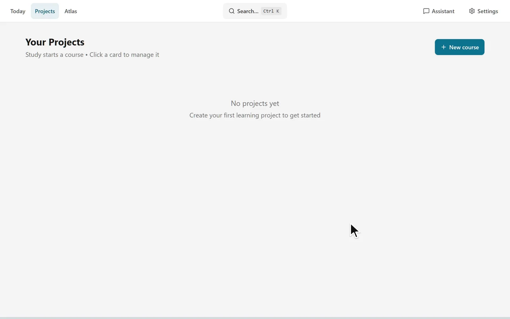
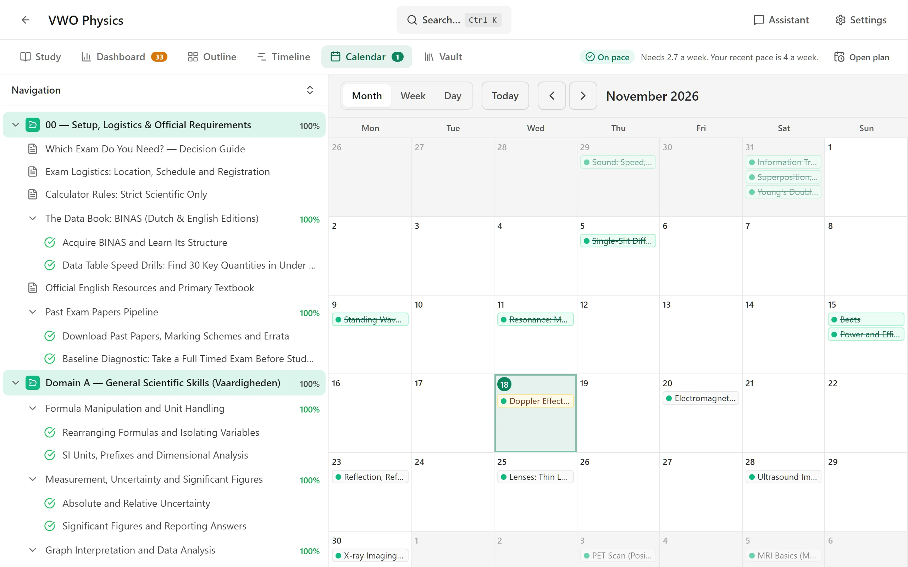
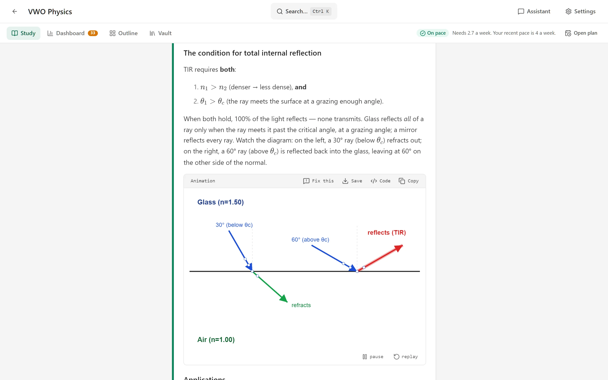
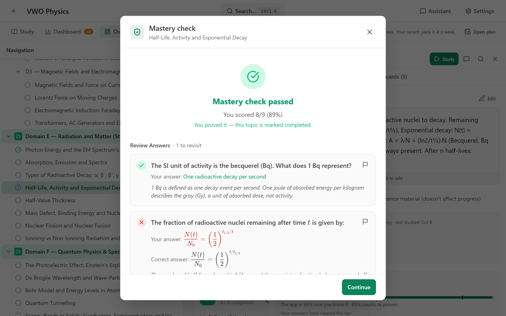
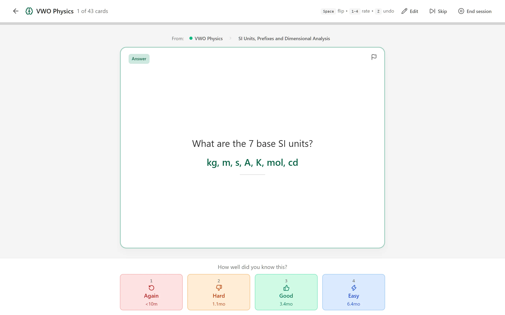
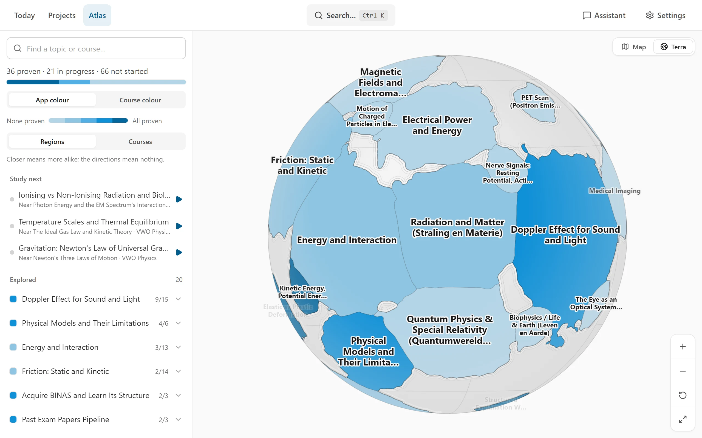

<p align="center">
  <picture>
    <source media="(prefers-color-scheme: dark)" srcset="brand/terramentor-wordmark-dark.png">
    
  </picture>
</p>

<p align="center"><b>Learn almost anything, from scratch to proven mastery. AI gets better, so do you.</b></p>

<p align="center">
  <a href="https://github.com/ValeraZSD/terramentor/releases">Download</a> ·
  <a href="#install">Install</a> ·
  <a href="docs/GETTING_STARTED.md">First steps</a> ·
  <a href="CHANGELOG.md">Changelog</a>
</p>

<p align="center">
  <a href="https://github.com/ValeraZSD/terramentor/releases"></a>
  <a href="LICENSE"></a>
  <a href="SECURITY.md"></a>
  
</p>

Tell Terramentor what you want to learn and by when. The model you connect drafts the course
and writes every lesson, diagram and question. Terramentor plans the course against your
deadline, asks you to prove each topic rather than tick it off, and brings back what you are
starting to forget. The app is free and has no account. The model is paid per use under your
own key, covered by a ChatGPT Plus or Pro plan you already have, or run on your own computer.



## How it works, and why

A chatbot explains anything you ask, and the AI companies' study modes add quizzes and
flashcards, but their own pages describe no reviews timed to when you are about to forget and no
check you must pass before a topic counts. Anki times the reviews, once you have written the
cards or found a deck. Terramentor runs the whole loop. Each step below says what it does and,
where there is research behind it, what that research found. The pictures come from one physics
course.

### Discover

Describe what you want to learn and the model drafts a course: phases, then topics, each with an
overview, in your language. Add a book or your notes and the course follows their chapters, and
its lessons draw on their pages. The draft runs in the background, so you can keep
studying meanwhile. Material can be any mix of files and links (a page, a PDF, a YouTube video),
and you never pick a size: a small source with a plain goal can become a short course of a few
topics with no dates, and anything the model cannot judge is built in phases. You can also import
a course file or an Anki deck.

### Plan

Give it a start date, a deadline and the days of the week you study. Your pace is measured
week by week against what the date needs, and after your first two weeks of study the course's
header says in one line whether you will make it. Open the plan to see your weeks as bars, the pace the date needs drawn across them,
and what to do if it slips: plan a set number a week, study only the topics that fit, or move
the date.



### Study

The home page is a stream, one course at a time: lessons in short parts, a question after each
part, flashcards, and questions from earlier topics you are starting to forget. Diagrams, charts and animations are
written by the model as code and checked before you see them. The assistant, open beside any
screen, teaches the topic in front of you, answers from your own files, looks at a photo or a
document you attach, and can change a course for you, with Undo.

Being asked about what you just read makes it stick better than reading it again, and more so
when each answer comes with why it is right or wrong; both have strong research records.



### Prove

A topic is proven when you pass its mastery check (choices, numbers you work out, answers you
type, steps you put in order, a sentence or an equation you build from pieces; code if you ask
for it, with Python and JavaScript run against tests on your own device), or when you
work an exercise on paper, photograph it and have it marked. Before you see a question with one right answer, the model answers it again without the answer key, and a
key it disputes is thrown out. That catches slips in the key before a question reaches you. You
can always skip a topic; it then stays marked as skipped, not as known. A pass mark before moving
on has a weaker, more mixed research record than testing and feedback; Terramentor keeps it so
that a topic counts only once you have answered for it.



### Remember

Flashcards come back just before you would forget them (scheduled with FSRS-7, the newest FSRS,
and fitted to your own reviews once there are enough of them). Reviews spread over days beat the
same reviews crammed together, by a wide margin in the studies below.
Every two weeks or so a course offers a look back: ten questions from across it, and a topic you
miss comes back as a question the next day you study. In the weeks before an exam whose date cannot
move, or one you have described, the offer is a full mock exam: the course's own questions on
screen, or a past paper you add, with an exam clock if you want one.
Anki decks come in with their media and review history and go back out as `.apkg`.



### The atlas

Every topic in your library on a map, or on a planet you can turn, placed by what it is about
rather than which course it belongs to; zoom in and each region splits into cities, one per
topic. Pick a course and it replays the order you finished its topics in,
and can save the replay as a video or a GIF. The list beside it opens with up to three topics to study next,
each close in meaning to one you have finished. Drawing it takes an embedding model, a second,
small model that groups topics by meaning ([where to get one](#the-model-is-the-teacher));
everything else works without it.



### Built like a course, not a chatbot

Trials of AI in teaching are mixed: students given a plain chatbot for maths practice leaned on
it and did worse on the exam after, while trials that built the AI into set lessons found gains
from 0.06 to 0.63 standard deviations, two of them against pupils who had no extra lessons at
all. Terramentor is built like the set lessons. The model writes the lessons, the questions and
their answer keys before you start. The app itself, with no model involved, decides what you see
next, the pass mark and when each review is due. A model marks typed and photographed answers,
and nothing said in the chat counts as proof. None of these studies tested Terramentor itself.

<picture>
  <source media="(min-width: 1170px)" srcset="docs/evidence/effect-sizes-wide.svg">
  <source media="(min-width: 584px) and (max-width: 767.98px), (min-width: 848px) and (max-width: 1169.98px)" srcset="docs/evidence/effect-sizes-medium.svg">
  <source media="(prefers-color-scheme: dark)" srcset="docs/evidence/effect-sizes-dark.svg">
  
</picture>

The studies behind each step, and what the AI companies' own study modes offer, are in
[Why it works](docs/WHY_IT_WORKS.md).

## The model is the teacher

Lessons and questions are written by the model you connect, pitched at what you told it about
yourself. Switch to a newer model and the next lessons are better, with no app update.

A hosted model is the right choice for most people; a model on your own computer teaches well
with 24 GB of video memory or more. A lesson is written once and kept, so you pay for writing it,
never for reading it again, and the provider's dashboard shows what you have spent.

Settings → AI & Models connects any of these; the welcome screens offer all but the ChatGPT plan:

- **OpenRouter**: **Connect OpenRouter** signs you in at openrouter.ai and brings back a key you
  own, for models from every major lab on one account.
- **ChatGPT**: sign in and use your own ChatGPT Plus or Pro plan, with no key.
- **Your own key** from Anthropic, OpenAI, Google, DeepSeek, Z.ai, Alibaba (Qwen) or Moonshot AI
  (Kimi).
- **Your own computer or server**: Ollama, LM Studio, llama.cpp, or any address that speaks the
  OpenAI API.

The embedding model the atlas needs also searches your files by meaning; without it, that search
goes by keywords. On OpenRouter the app picks one for you, on Ollama it uses `nomic-embed-text`,
and on another endpoint you choose one it offers under Settings → AI & Models. A ChatGPT plan and
Anthropic serve none, so with those the embeddings can run on Ollama.

Without a model you can import a course file or an Anki deck and study its saved lessons,
questions and flashcards. To get a course with no key at all, open **New course → Import a
course → Or make a course with an external chatbot**: copy the prompt into a chatbot you already
use and paste its reply back. The course arrives with its outline, an overview of each topic and
links to read, and a second prompt per phase writes a reading for each topic. Writing questions,
flashcards, lessons and visuals, and the assistant, take a connected model.

## Your data

Your library is one SQLite file on your own disk, with a folder beside it for documents and card
media. Nothing reports back to this project. What leaves the machine is what a lesson or an
answer needs, sent to the model provider you chose, and web pages: searches for reading on a
course's topics while it is drafted, and a topic's links read when its lessons are written (both
on by default, two switches in Settings → AI & Models). [SECURITY.md](SECURITY.md) lists every
outbound connection.

## Accessibility

You can study, review cards and answer questions with only a keyboard, and NVDA reads a card
review, a quiz and maths. Any list or card you can drag also moves from the keyboard. Settings
→ General → Text & interface size makes everything up to 160% of its usual size, and Settings →
Accessibility holds contrast, motion, text spacing, larger text and buttons, a reading line,
reading aloud, time limits, confirming before an answer is graded and the single-key shortcuts. The target is WCAG 2.2 AA; [docs/ACCESSIBILITY.md](docs/ACCESSIBILITY.md)
says how that is tested, gives the status of each criterion, and how to report a barrier.

## Install

**Desktop.** Download the zip for your system from the
[releases page](https://github.com/ValeraZSD/terramentor/releases), unpack it and start
`Terramentor.exe` (Windows), `Terramentor.app` (macOS, Apple Silicon) or `./terramentor.sh`
(Linux). There is nothing else to install. The launcher is unsigned, so Windows asks once
(*More info → Run anyway*). On a Mac, drag `Terramentor.app` into Applications first; if macOS
blocks it the first time, open *System Settings*, then *Privacy & Security*, and press *Open Anyway*.

**Docker:**

```bash
curl -O https://raw.githubusercontent.com/ValeraZSD/terramentor/main/docker-compose.yml
docker compose up -d
```

Then open <http://127.0.0.1:3001>.

**From source** (Node.js 24.7 or a later 24 or 25 release; CI tests on 24):

```bash
git clone https://github.com/ValeraZSD/terramentor.git
cd terramentor
npm ci
npm run standalone
```

Updates, the Docker password and phone access are in [docs/INSTALL.md](docs/INSTALL.md). The
interface comes in fourteen languages, Arabic right to left ([docs/I18N.md](docs/I18N.md)).

## Documentation

- [First steps](docs/GETTING_STARTED.md): a five-minute tour.
- [Install and update](docs/INSTALL.md): desktop, Docker, from source, phone access, upgrades.
- [Why it exists](CoreIdea.md): what this is for, and what it is not.
- [Why it works](docs/WHY_IT_WORKS.md): the research behind the loop, and its limits.
- [MCP server](docs/MCP.md): let Claude Code, Claude Desktop, VS Code or Cursor read your
  library and tell it how you answered. Where that app can show it, you take the mastery check
  or a card review right in its window.
- [Architecture](docs/ARCHITECTURE.md): React and TypeScript, Node and SQLite, and why. Start
  here to contribute.
- [Technical reference](TECHNICAL_DOCUMENTATION.md): schema, engines, API.
- [Security](SECURITY.md): threat model and every outbound connection.
- [Accessibility](docs/ACCESSIBILITY.md): what is tested and the WCAG 2.2 report.
- [Contributing](CONTRIBUTING.md), [Roadmap](ROADMAP.md), [Changelog](CHANGELOG.md).

Found a wrong lesson or a bug? **Settings → Library & about → About → Report a problem** fills in
GitHub's form for you to check and send.

## Licence

Copyright © 2026 Valerii Kozhevets (ValeraZSD). **AGPL-3.0-or-later**, see [LICENSE](LICENSE);
third-party code is listed in [THIRD_PARTY_NOTICES.md](THIRD_PARTY_NOTICES.md). The running app
links to its own source under Settings → Library & about → About.
